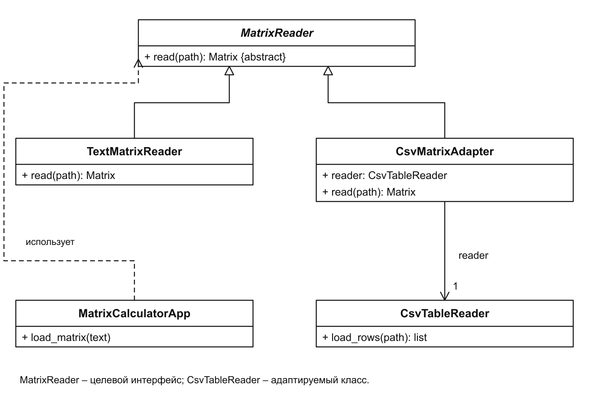
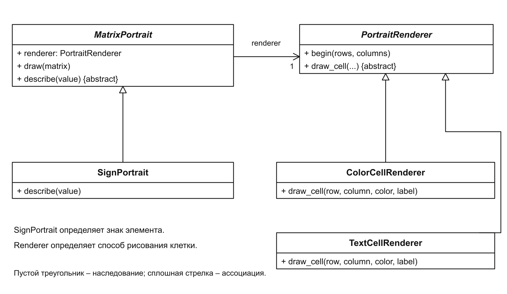
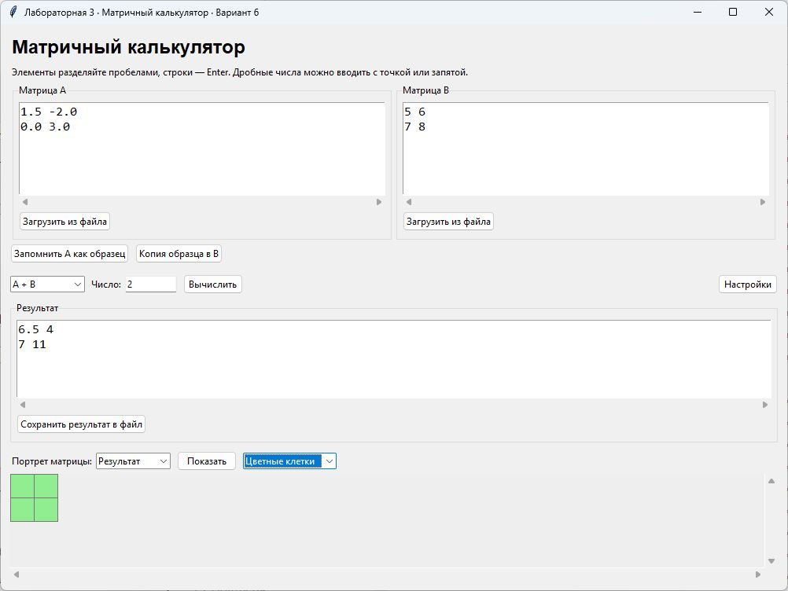
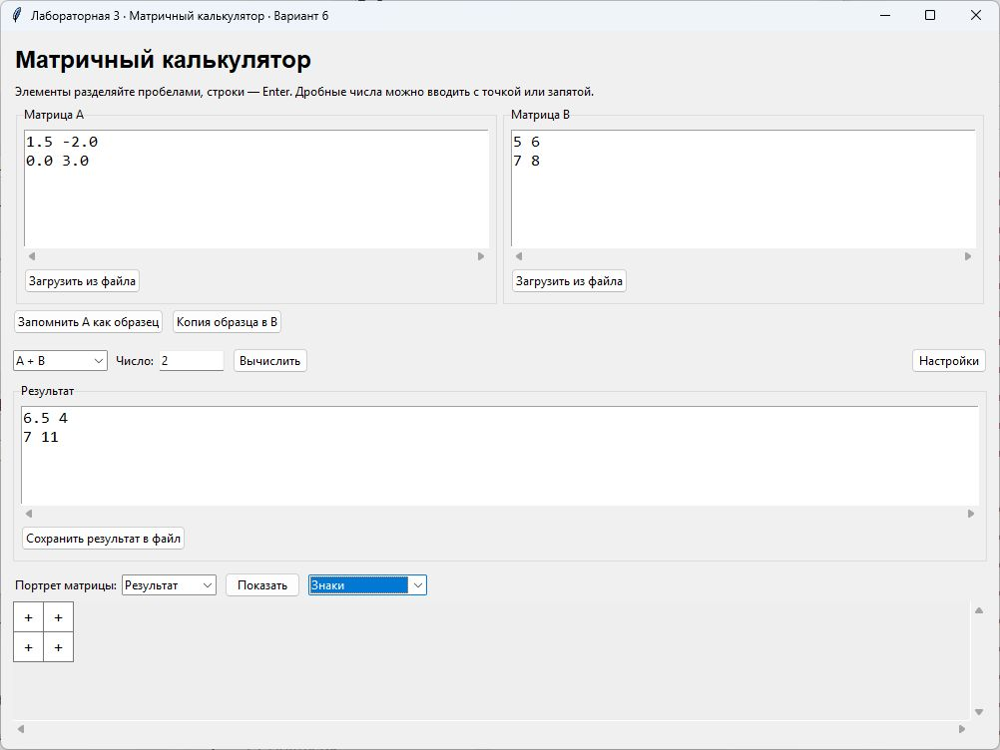

# Лабораторная работа № 3

Структурные паттерны: Адаптер, Мост

Выполнил: Хатуаева Дайана Тныбековна 4 курс, группа ПИЖ-б-о-23-2, 09.03.04 «Программная инженерия», очная форма обучения

Проверил: ассистент департамента цифровых, робототехнических систем и электроники, Института Перспективной Инженерии Белик А.И

Цель работы: подключить чтение матриц из CSV и отделить логику портрета матрицы от способа его рисования.

Задача: применить структурные паттерны «Адаптер» и «Мост» в приложении «Матричный калькулятор».

Вариант 6 – Матричный калькулятор

Репозиторий: [https://github.com/Diana130613/patterny-proektirovaniya](https://github.com/Diana130613/patterny-proektirovaniya)

## Реализация и принцип работы

## Адаптер

Калькулятору для вычислений нужен объект Matrix. Но CsvTableReader возвращает список строковых ячеек: такие данные ещё нельзя передать матричным операциям. Кроме того, у него есть метод load_rows(), а приложение ожидает read(). Адаптер устраняет эту несовместимость: CsvMatrixAdapter использует готовый CSV-считыватель и возвращает матрицу через общий интерфейс MatrixReader.



Рисунок 1 – Адаптер чтения матрицы из CSV

На диаграмме адаптер связывает две стороны: для приложения он является MatrixReader, а внутри обращается к CsvTableReader. Благодаря этому особенности CSV сосредоточены в одном классе. Остальная программа работает с матрицей так же, как после загрузки TXT.

В приведённом коде видно, как адаптер превращает результат CSV-считывателя в объект, пригодный для вычислений:

```python
class CsvMatrixAdapter(MatrixReader):
    def __init__(self, reader):
        self.reader = reader
    def read(self, path) -> Matrix:
        rows = self.reader.load_rows(path)
        data = [[Matrix.number(cell) for cell in row]
                for row in rows]
        return Matrix(data)
```

Например, строка CSV «1,5;-2» сначала читается как две строки: «1,5» и «-2». Matrix.number() превращает их в числа 1.5 и -2, а Matrix(data) собирает строки в матрицу. Смысл адаптера в том, чтобы выполнить это преобразование на границе загрузки и передать дальше уже готовые данные.

Выбор формата остаётся в одном месте. После выбора считывателя приложение вызывает read() и получает Matrix:

```python
if path.lower().endswith(".csv"):
    reader = CsvMatrixAdapter(CsvTableReader())
else:
    reader = TextMatrixReader()
matrix = reader.read(path)
```

Так код вычислений не зависит от формата файла. Если потребуется другой формат, можно добавить считыватель с тем же интерфейсом, сохранив существующие матричные операции.

## Мост

При построении портрета решаются две задачи: определить, что означает число, и выбрать, как показать его на экране. SignPortrait определяет знак элемента, а ColorCellRenderer и TextCellRenderer отображают его цветной клеткой или символом. Мост связывает эти части через объект renderer, поэтому правило определения знака и способ рисования можно менять независимо.



Рисунок 2 – Связь портрета матрицы со способом рисования

Метод draw() передаёт цвет и подпись исполнителю:

```python
def draw(self, matrix):
    self.renderer.begin(matrix.rows, matrix.columns)
    for i, row in enumerate(matrix.data):
        for j, value in enumerate(row):
            color, label = self.describe(value)
            self.renderer.draw_cell(i, j, color, label)
```

Для числа -2 describe() выбирает цвет отрицательных элементов и знак «−». Один исполнитель рисует цветную клетку, другой показывает символ. Определение знака остаётся общим: при смене режима меняется только способ его отображения.

В show_portrait() выбранный исполнитель передаётся SignPortrait:

```python
renderer_class = (TextCellRenderer
                  if self.portrait_mode.get() == "Знаки"
                  else ColorCellRenderer)
renderer = renderer_class(self.canvas, settings)
portrait = SignPortrait(renderer, settings)
portrait.draw(matrix)
```

Новый способ рисования добавляется отдельным классом PortraitRenderer. Новое правило, например разделение чисел на малые и большие, можно оформить другим портретом и использовать с ним тех же исполнителей. Это избавляет от повторения кода для каждой комбинации правила и способа рисования.

## Результат работы программы

В матрицу A загружен CSV-файл со строками «1,5;-2» и «0;3». Адаптер преобразовал их в матрицу [[1.5, -2], [0, 3]]. Для матрицы B = [[5, 6], [7, 8]] операция A + B дала [[6.5, 4], [7, 11]]. На рисунке 3 показаны загруженные данные, результат сложения и его цветной портрет.



Рисунок 3 – Загрузка CSV и результат сложения матриц

После выбора режима «Знаки» результат отображается знаками элементов. Все четыре числа суммы положительные, поэтому на портрете показаны четыре знака «+». Меняется только способ рисования; матрицы и результат вычисления остаются прежними.



Рисунок 4 – Отображение результата в режиме «Знаки»

Вывод: в результате выполнения лабораторной работы паттерн адаптер позволил подключить CSV к общему интерфейсу чтения матриц, а мост отделил определение знака элемента от рисования и позволил выбирать вид портрета.
