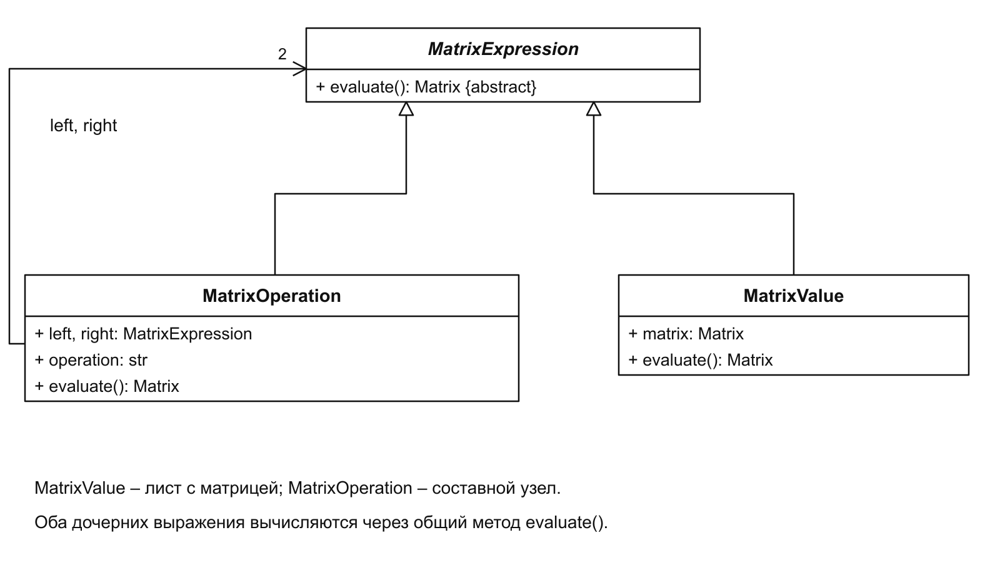
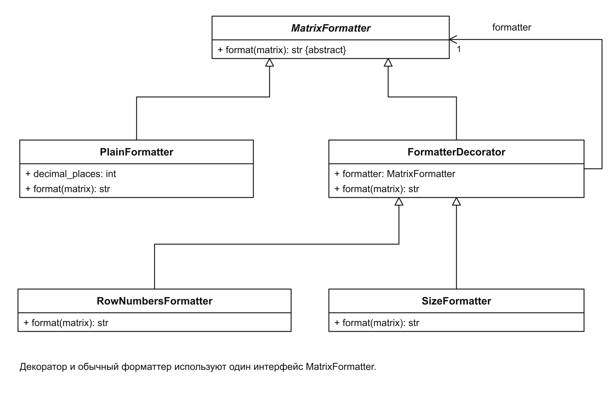
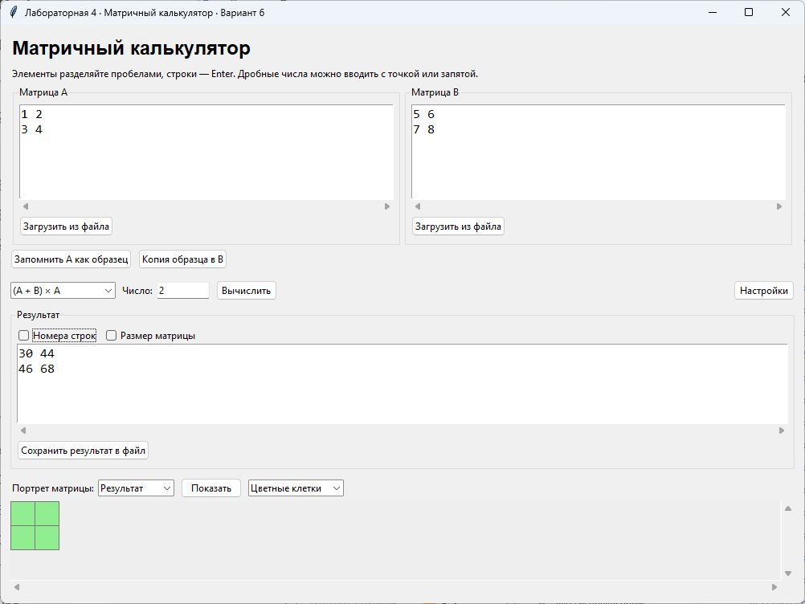
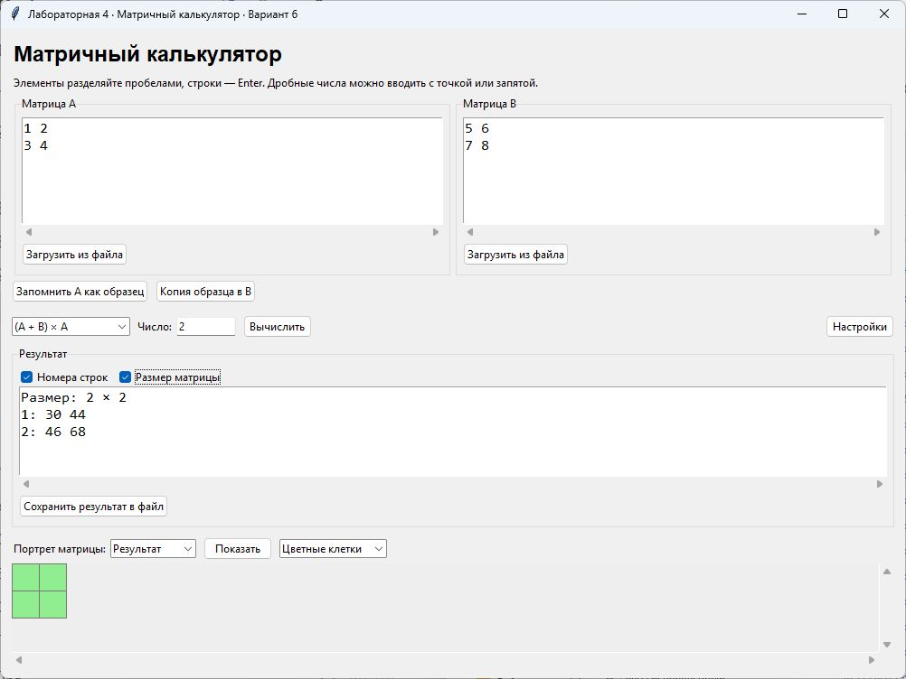

# Лабораторная работа № 4

Структурные паттерны: компоновщик, декоратор

Выполнил: Хатуаева Дайана Тныбековна 4 курс, группа ПИЖ-б-о-23-2, 09.03.04 «Программная инженерия», очная форма обучения

Проверил: ассистент межинститутской базовой кафедры Белик А.И

Цель работы: вычислять составные матричные выражения и добавлять оформление результата без изменения алгоритмов операций.

Задача: применить структурные паттерны «Компоновщик» и «Декоратор» в приложении «Матричный калькулятор».

Вариант 6 – Матричный калькулятор

Репозиторий: [https://github.com/Diana130613/patterny-proektirovaniya](https://github.com/Diana130613/patterny-proektirovaniya)

## Реализация и принцип работы

## Компоновщик

MatrixExpression задаёт общий метод evaluate(). MatrixValue хранит отдельную матрицу, а MatrixOperation содержит два дочерних выражения и операцию. Дочерним выражением может быть как матрица, так и другой составной объект. Поэтому выражение (A + B) × A представляется деревом.



Рисунок 1 – Отдельная матрица и составное выражение

На диаграмме лист MatrixValue и составной узел MatrixOperation имеют общий интерфейс. Поля left и right ссылаются на MatrixExpression, поэтому в них можно передать выражения любой глубины.

MatrixOperation сначала вычисляет дочерние выражения, затем выполняет выбранную операцию:

```python
def evaluate(self):
    left = self.left.evaluate()
    right = self.right.evaluate()
    if self.operation == "+":
        return left.add(right)
    if self.operation == "-":
        return left.subtract(right)
    return left.multiply(right)
```

Вызовы self.left.evaluate() и self.right.evaluate() выполняются рекурсивно. Если дочерний объект является листом, он возвращает готовую матрицу. Если это составной узел, он сначала вычисляет собственные дочерние выражения.

В calculate() выражение (A + B) × A собирается из двух узлов. Клиент получает результат одним вызовом evaluate():

```python
total = MatrixOperation(MatrixValue(a), MatrixValue(b), "+")
expression = MatrixOperation(total, MatrixValue(a), "*")
result = expression.evaluate()
```

Объект total представляет сумму A и B. Он становится левой частью умножения, а правая часть хранит A. Сначала вычисляется сумма, затем её результат умножается на A. Проверку совместимости размеров выполняют методы класса Matrix.

## Декоратор

MatrixFormatter задаёт метод format(matrix). PlainFormatter возвращает обычный текст матрицы. FormatterDecorator хранит другой форматтер с тем же интерфейсом. RowNumbersFormatter добавляет номера строк, а SizeFormatter – размер матрицы. Декораторы можно включать отдельно или вместе.



Рисунок 2 – Форматтер результата и его декораторы

SizeFormatter получает текст вложенного форматтера и добавляет к нему размер:

```python
class SizeFormatter(FormatterDecorator):
    def format(self, matrix):
        text = self.formatter.format(matrix)
        return f"Размер: {matrix.rows} × {matrix.columns}\n{text}"
```

Поле self.formatter хранит обёрнутый объект. Вызов его метода format() передаёт ему работу, после чего SizeFormatter дополняет полученную строку. Матрица и её числовые значения при этом не меняются.

В update_result_text() флажки определяют, какие декораторы оборачивают обычный форматтер:

```python
formatter = PlainFormatter(self.settings.values["decimal_places"])
if self.row_numbers.get():
    formatter = RowNumbersFormatter(formatter)
if self.show_size.get():
    formatter = SizeFormatter(formatter)
self.result_text.insert("1.0", formatter.format(self.result))
```

Если включены оба флажка, получается цепочка SizeFormatter(RowNumbersFormatter(PlainFormatter(...))). Обычный форматтер создаёт текст, следующий добавляет номера строк, а внешний помещает сверху размер. Без флажков используется только PlainFormatter.

## Результат работы программы

Для матриц A = [[1, 2], [3, 4]] и B = [[5, 6], [7, 8]] выбрано выражение (A + B) × A. Сначала получена сумма [[6, 8], [10, 12]], затем результат умножения [[30, 44], [46, 68]]. На рисунке 3 показан обычный вывод результата.



Рисунок 3 – Вычисление составного выражения (A + B) × A

После включения флажков «Номера строк» и «Размер матрицы» к тексту добавлены номера строк и подпись «Размер: 2 × 2». Значения 30, 44, 46 и 68 не изменились. Это показывает, что декораторы дополняют оформление уже вычисленной матрицы.



Рисунок 4 – Результат с номерами строк и размером матрицы

Вывод: подводя итоги, можно сказать о том, что были изучены паттерны компоновщик и декоратор. Компоновщик позволил работать с отдельными матрицами и вложенными выражениями через общий метод evaluate(). Декоратор добавил номера строк и размер матрицы без изменения вычислений.
