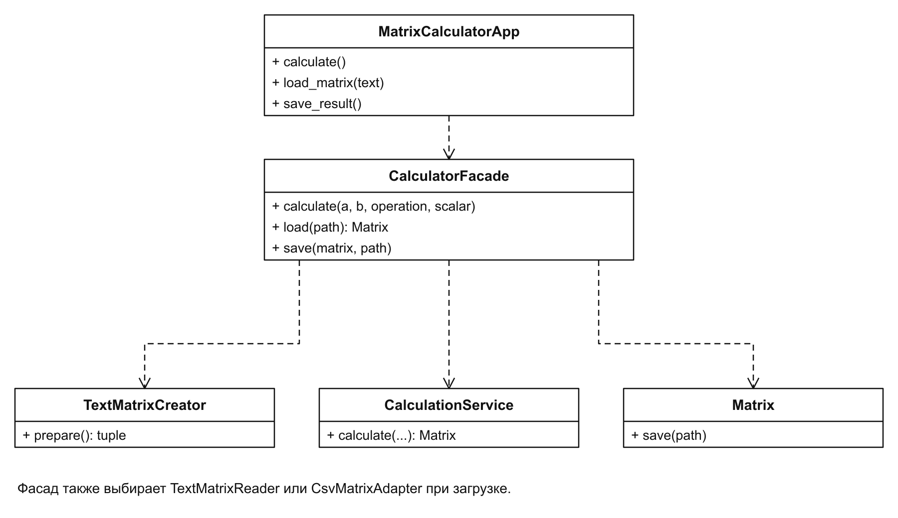
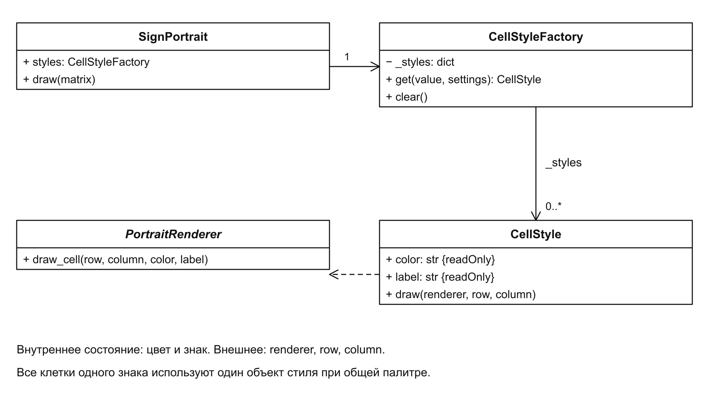
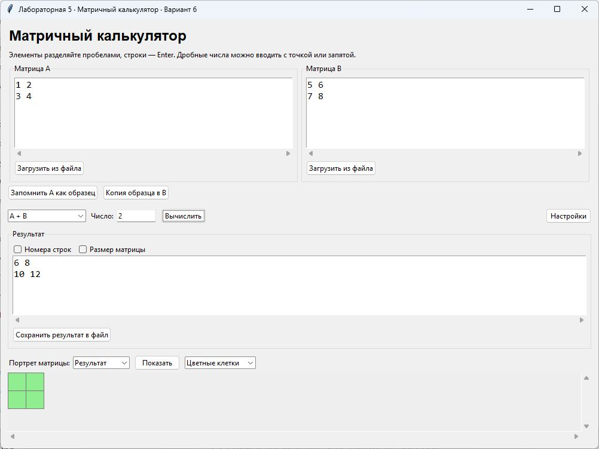

# Лабораторная работа № 5

Структурные паттерны: фасад, приспособленец

Выполнил: Хатуаева Дайана Тныбековна 4 курс, группа ПИЖ-б-о-23-2, 09.03.04 «Программная инженерия», очная форма обучения

Проверил: ассистент межинститутской базовой кафедры Белик А.И

Цель работы: упростить обращение к операциям калькулятора и организовать совместное использование стилей клеток портрета.

Задача: применить структурные паттерны «Фасад» и «Приспособленец» в приложении «Матричный калькулятор».

Вариант 6 – Матричный калькулятор

Репозиторий: [https://github.com/Diana130613/patterny-proektirovaniya](https://github.com/Diana130613/patterny-proektirovaniya)

## Реализация и принцип работы

## Фасад

CalculatorFacade предоставляет окну три метода: calculate(), load() и save(). Фасад подготавливает матрицы, выбирает считыватель TXT или CSV и передаёт вычисление в CalculationService. Окну не нужно самостоятельно связывать эти классы.



Рисунок 1 – Фасад и используемые им классы

На диаграмме окно обращается к CalculatorFacade, а фасад использует объекты для создания, чтения, вычисления и сохранения матриц. Общий порядок работы сосредоточен в одном месте.

Метод calculate() получает строки из окна и превращает их в данные для вычислительного сервиса:

```python
def calculate(self, a_text, b_text, operation, scalar_text=""):
    a, _ = TextMatrixCreator(a_text).prepare()
    b = None
    scalar = None
    if operation == "A × число":
        scalar = Matrix.number(scalar_text)
    else:
        b, _ = TextMatrixCreator(b_text).prepare()
    return self.calculator.calculate(a, b, operation, scalar)
```

Матрица A создаётся для любой операции. Если выбрано умножение на число, разбирается множитель; в остальных случаях создаётся матрица B. После подготовки фасад вызывает один метод вычислительного сервиса.

В обработчике кнопки «Вычислить» остаётся обращение к фасаду:

```python
result = self.facade.calculate(
    self.a_text.get("1.0", "end"),
    self.b_text.get("1.0", "end"),
    self.operation.get(), self.scalar.get())
```

## Приспособленец

CellStyle хранит цвет и знак элемента матрицы. CellStyleFactory возвращает общий объект стиля для одинакового оформления. Поэтому несколько положительных клеток используют один стиль, хотя рисуются в разных местах.



Рисунок 2 – Общие стили клеток портрета

Цвет и знак являются общими данными стиля. Координаты клетки и объект renderer передаются при рисовании и в самом стиле не хранятся. CellStyle объявлен неизменяемым, поэтому одна клетка не может изменить оформление остальных.

Фабрика выбирает ключ по знаку числа и создаёт стиль только при первом обращении:

```python
def get(self, value, settings):
    if value > 0:
        key = (settings["positive_color"], "+")
    elif value < 0:
        key = (settings["negative_color"], "−")
    else:
        key = (settings["zero_color"], "0")
    if key not in self._styles:
        self._styles[key] = CellStyle(*key)
    return self._styles[key]
```

Для одной палитры достаточно трёх стилей: положительного, отрицательного и нулевого. При повторном ключе возвращается уже созданный объект из словаря _styles.

При построении портрета каждая клетка получает стиль из фабрики:

```python
style = self.styles.get(value, self.settings)
style.draw(self.renderer, row, column)
```

## Результат работы программы

Для A = [[1, 2], [3, 4]] и B = [[5, 6], [7, 8]] фасад вернул сумму [[6, 8], [10, 12]]. На рисунке показаны исходные матрицы, результат и его цветной портрет.



Рисунок 3 – Сложение матриц через фасад и портрет результата

Все четыре элемента результата положительные, поэтому четыре клетки используют один общий стиль. Отдельная проверка фабрики для значений 1, 2, 0, -1, -2, 0 создаёт три стиля на шесть обращений. Значения 1 и 2 получают один и тот же объект.

Вывод: в результате выполнения лабораторной работы были изучены паттерны фасад и приспособленец. Фасад упростил обращение окна к вычислению, загрузке и сохранению матриц. Приспособленец позволил повторно использовать общие стили клеток, передавая их координаты отдельно.
