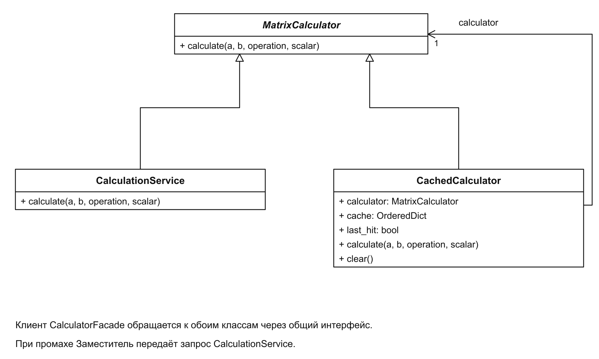
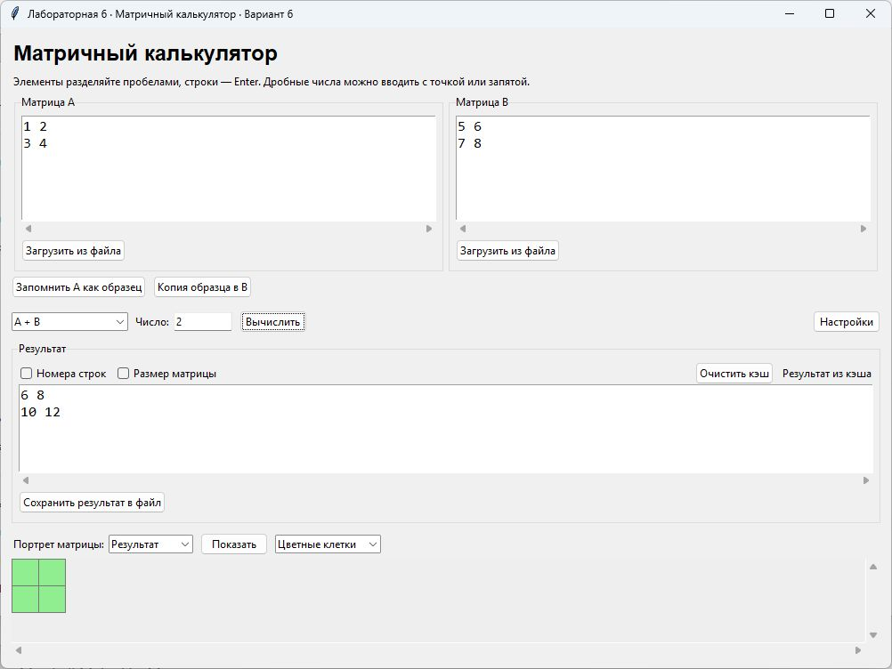

# Лабораторная работа № 6

Структурные паттерны: заместитель

Выполнил: Хатуаева Дайана Тныбековна 4 курс, группа ПИЖ-б-о-23-2, 09.03.04 «Программная инженерия», очная форма обучения

Проверил: ассистент межинститутской базовой кафедры Белик А.И

Цель работы: организовать повторное использование результатов матричных операций с помощью кэширующего заместителя.

Задача: применить структурный паттерн «Заместитель» в приложении «Матричный калькулятор».

Вариант 6 – Матричный калькулятор

Репозиторий: [https://github.com/Diana130613/patterny-proektirovaniya](https://github.com/Diana130613/patterny-proektirovaniya)

## Реализация и принцип работы

## Заместитель

MatrixCalculator задаёт общий метод calculate(). CalculationService выполняет матричную операцию, а CachedCalculator проверяет, есть ли готовый результат в кэше. Оба класса имеют один интерфейс, поэтому фасад работает с заместителем так же, как с обычным сервисом.



Рисунок 1 – Вычислительный сервис и кэширующий заместитель

На диаграмме CachedCalculator хранит ссылку на вычислительный сервис. Если сохранённого результата нет, заместитель передаёт ему запрос. При повторном запросе возвращается результат из кэша.

Ключ кэша включает матрицы, операцию и множитель. Он строится из кортежей со значениями элементов:

```python
left = tuple(tuple(row) for row in a.data)
if operation == "A × число":
    right = None
else:
    right = tuple(tuple(row) for row in b.data)
    scalar = None
key = (left, right, operation, scalar)
```

Для умножения на число матрица B не используется. Для остальных операций не используется множитель. Если нужные входные значения или операция изменятся, ключ будет другим и потребуется новое вычисление.

Основная часть calculate() проверяет кэш и при необходимости вызывает сервис:

```python
if key in self.cache:
    self.last_hit = True
    self.cache.move_to_end(key)
    return self.cache[key].clone()
result = self.calculator.calculate(a, b, operation, scalar)
self.cache[key] = result.clone()
if len(self.cache) > self.capacity:
    self.cache.popitem(last=False)
return result
```

Метод clone() создаёт копию матрицы. Поэтому изменение возвращённого результата не повреждает данные в кэше. Кэш хранит до 20 запросов; при заполнении удаляется запись, которая дольше остальных не использовалась.

В окне заместитель передаётся фасаду при создании приложения:

```python
self.calculator = CachedCalculator()
self.facade = CalculatorFacade(self.calculator)
```

Свойство last_hit определяет надпись «Результат вычислен» или «Результат из кэша». Кнопка «Очистить кэш» вызывает clear() и удаляет сохранённые результаты.

## Результат работы программы

Для A = [[1, 2], [3, 4]] и B = [[5, 6], [7, 8]] выбрано сложение. При первом нажатии «Вычислить» получена сумма [[6, 8], [10, 12]] и показана надпись «Результат вычислен».


Рисунок 2 – Первое вычисление результата

Повторное нажатие с теми же данными возвращает ту же матрицу, но надпись меняется на «Результат из кэша». Сервис повторно не выполняет сложение.



Рисунок 3 – Повторный запрос с использованием кэша

Вывод: в результате выполнения лабораторной работы был изучен паттерн заместитель. CachedCalculator позволил повторно использовать результаты матричных операций через общий интерфейс вычислительного сервиса. Копирование матриц защищает содержимое кэша, а кнопка очистки позволяет удалить сохранённые результаты.
