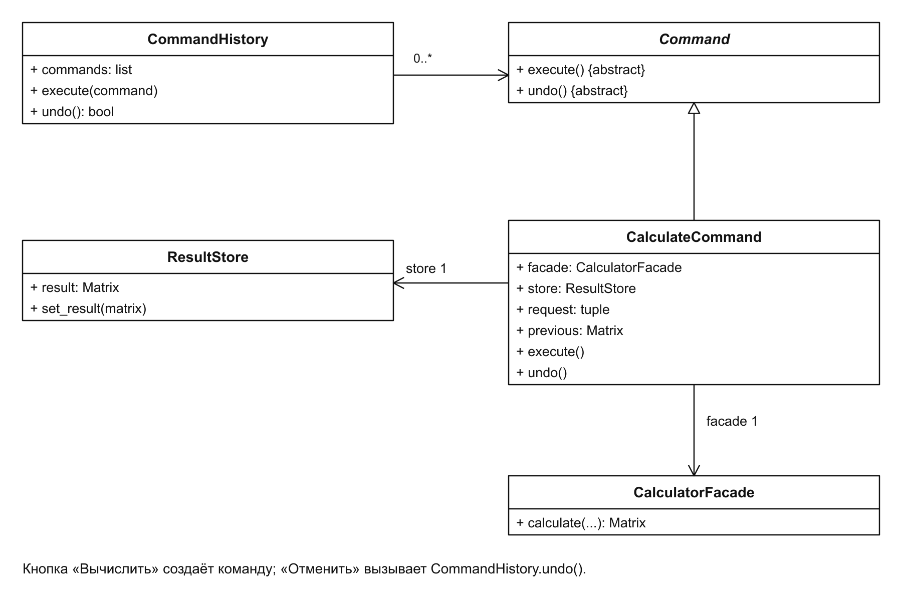
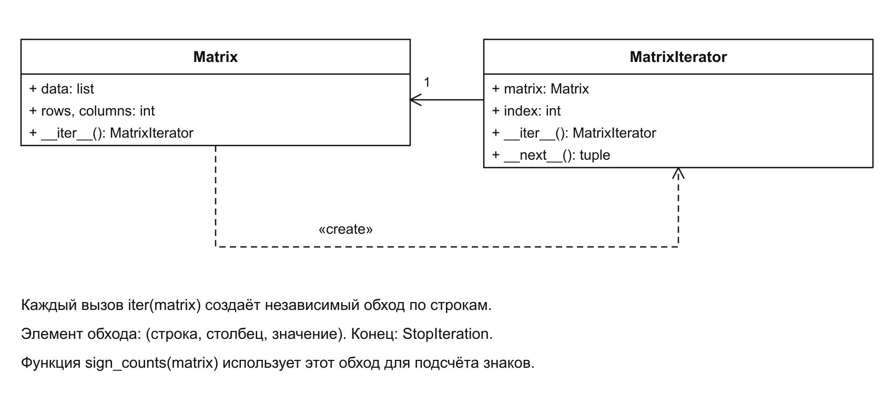
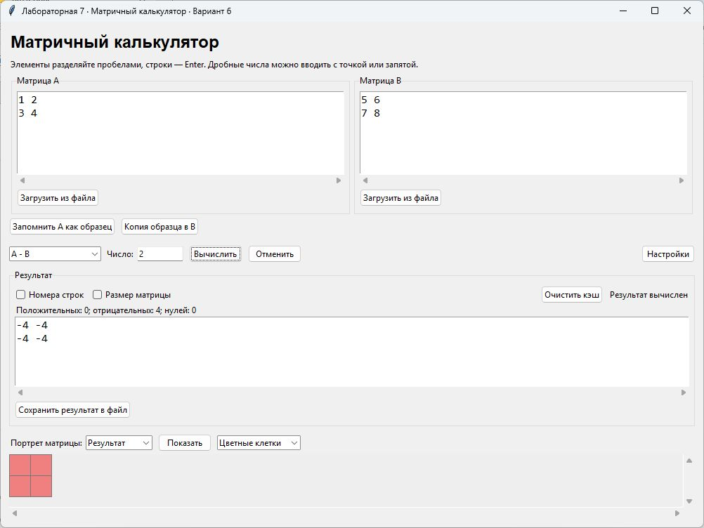
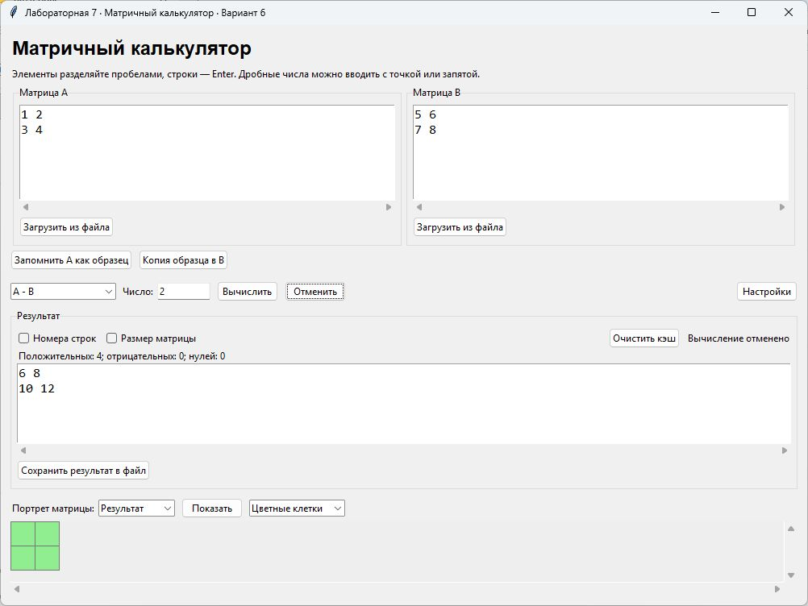

# Лабораторная работа № 7

Поведенческие паттерны: команда, итератор

Выполнил: Хатуаева Дайана Тныбековна 4 курс, группа ПИЖ-б-о-23-2, 09.03.04 «Программная инженерия», очная форма обучения

Проверил: ассистент департамента цифровых, робототехнических систем и электроники, Института Перспективной Инженерии Белик А.И

Цель работы: изучить паттерны «Команда» и «Итератор». Реализовать отмену вычислений и последовательный обход элементов матрицы.

Задача: реализовать решение задачи из предметной области с использованием паттернов, указанных в теме работы.

Вариант 6 – Матричный калькулятор

Репозиторий: [https://github.com/Diana130613/patterny-proektirovaniya](https://github.com/Diana130613/patterny-proektirovaniya)

## Приложение и средства разработки

Приложение на Python с интерфейсом Tkinter продолжает предыдущую работу. Сохранены операции, загрузка TXT и CSV, запись результата, портрет матрицы, копирование образца и семь настроек.

## Применение Команды

Для отмены вычисления нужно помнить, какой результат был в окне до него. Паттерн «Команда» представляет действие отдельным объектом CalculateCommand: он хранит запрос и предыдущее состояние. Метод execute() выполняет запрос через фасад, а undo() возвращает сохранённый результат. ResultStore хранит текущее состояние, которое показывает окно.



Рисунок 1 – Команда вычисления и история отмены

CommandHistory хранит выполненные команды в порядке их выполнения. Кнопка «Отменить» обращается к последней команде, поэтому действия отменяются в обратном порядке. Команда добавляется в историю только после успешного вычисления: неверный ввод не должен создавать действие для отмены или заменять предыдущий результат.

## Исходный код Команды

```python
from abc import ABC, abstractmethod

class Command(ABC):
    @abstractmethod
    def execute(self):
        pass

    @abstractmethod
    def undo(self):
        pass

class ResultStore:
    def __init__(self):
        self.result = None

    def set_result(self, matrix):
        self.result = None if matrix is None else matrix.clone()

class CalculateCommand(Command):
    def __init__(self, facade, store, a, b, operation, scalar=""):
        self.facade = facade
        self.store = store
        self.request = (a, b, operation, scalar)
        self.previous = None

    def execute(self):
        result = self.facade.calculate(*self.request)
        old = self.store.result
        self.previous = None if old is None else old.clone()
        self.store.set_result(result)

    def undo(self):
        self.store.set_result(self.previous)

class CommandHistory:
    def __init__(self):
        self.commands = []

    def execute(self, command):
        command.execute()
        self.commands.append(command)

    def undo(self):
        if not self.commands:
            return False
        self.commands[-1].undo()
        self.commands.pop()
        return True
```

Для отмены не требуется подбирать обратную матричную операцию: команда восстанавливает сохранённое состояние. Копирование через clone() нужно, чтобы последующие изменения матрицы не изменили результат, к которому пользователь сможет вернуться.

Создание команды в обработчике окна:

```python
command = CalculateCommand(
    self.facade, self.store,
    self.a_text.get("1.0", "end"),
    self.b_text.get("1.0", "end"),
    self.operation.get(), self.scalar.get())
self.history.execute(command)
result = self.store.result
```

Например, после A + B и A − B первая отмена вернёт сумму, вторая уберёт результат. Поля A и B сохранят введённые матрицы: отменяется только изменение результата.

## Применение Итератора

Для подсчёта положительных, отрицательных и нулевых элементов нужно последовательно просмотреть матрицу. Паттерн «Итератор» отделяет порядок обхода от самого подсчёта. MatrixIterator выдаёт очередной элемент вместе с его координатами, а функция sign_counts() решает, к какому счётчику его отнести. Благодаря этому ей не нужно самой организовывать обход строк и столбцов.



Рисунок 2 – Матрица и её итератор

При вызове iter(matrix) создаётся новый итератор со своей позицией. Поэтому повторный обход начинается с первого элемента и не зависит от предыдущего. Один и тот же способ перебора можно использовать для подсчёта знаков, поиска элемента или другой обработки, меняя только действие над полученным значением.

## Исходный код Итератора

Подключение обхода в классе Matrix:

```python
def __iter__(self):
    from iterators import MatrixIterator
    return MatrixIterator(self)
```

Цикл for вызывает __next__() до сигнала StopIteration. Так матрица 2 × 3 выдаёт все шесть элементов, после чего обход заканчивается.

Итератор и подсчёт знаков:

```python
class MatrixIterator:
    def __init__(self, matrix):
        self.matrix = matrix
        self.index = 0

    def __iter__(self):
        return self

    def __next__(self):
        if self.index >= self.matrix.rows * self.matrix.columns:
            raise StopIteration
        row, column = divmod(self.index, self.matrix.columns)
        self.index += 1
        return row, column, self.matrix.data[row][column]

def sign_counts(matrix):
    positive = negative = zero = 0
    for row, column, value in matrix:
        if value > 0:
            positive += 1
        elif value < 0:
            negative += 1
        else:
            zero += 1
    return positive, negative, zero
```

## Результаты работы

Для A = [[1, 2], [3, 4]] и B = [[5, 6], [7, 8]] сначала вычислена сумма A + B, затем разность A − B. На рисунке 3 показан результат вычитания: все четыре элемента равны -4. Итератор обходит результат, поэтому строка статистики показывает четыре отрицательных элемента.



Рисунок 3 – Разность матриц и подсчёт отрицательных элементов

После нажатия «Отменить» восстановилась предыдущая сумма [[6, 8], [10, 12]]. Появилась надпись «Вычисление отменено», портрет стал зелёным, а статистика показала четыре положительных элемента. Так видны восстановление результата командой и его повторный обход итератором.



Рисунок 4 – Восстановление суммы после отмены вычисления

Вывод: в калькулятор добавлены «Команда» и «Итератор». Команда сохраняет запрос и позволяет отменять изменение результата через историю. Итератор предоставляет последовательный обход элементов матрицы и используется для подсчёта знаков без раскрытия её внутреннего списка.
