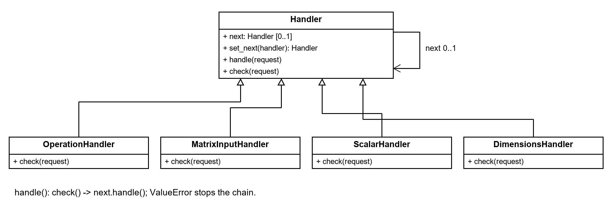
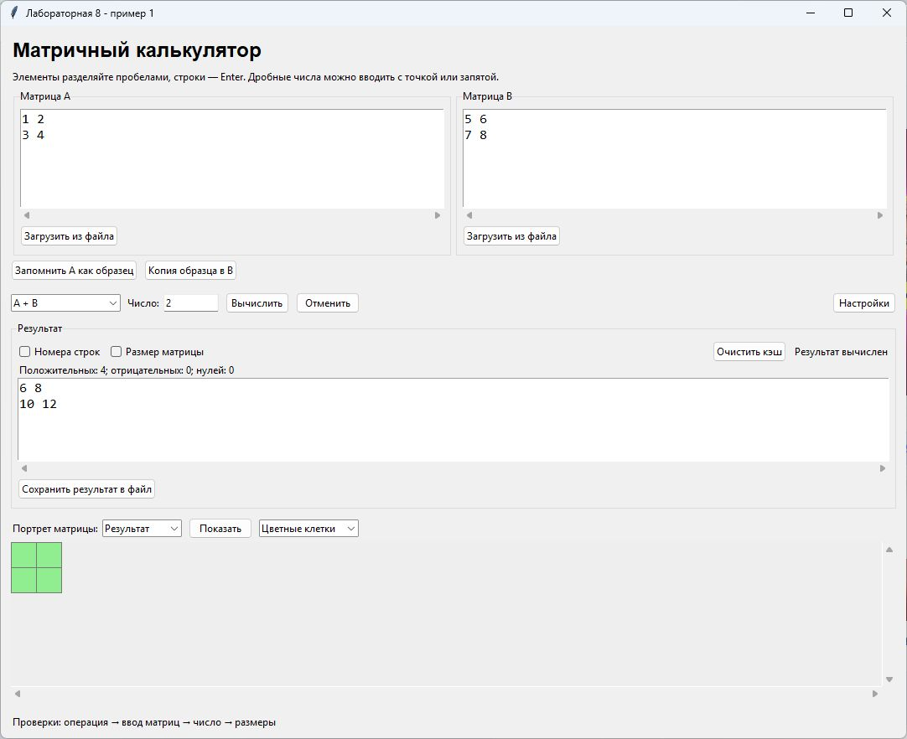

# Лабораторная работа 8
Цепочка обязанностей

Цель работы: организовать последовательную проверку запроса с помощью паттерна «Цепочка обязанностей».

Задача: применить паттерны, указанные в теме работы, в приложении «Матричный калькулятор».

Вариант 6 – Матричный калькулятор

Репозиторий проекта: https://github.com/Diana130613/patterny-proektirovaniya.

## Реализация и принцип работы

Перед вычислением нужно проверить выбранную операцию, числа и размеры матриц. Если собрать все проверки в обработчике кнопки, он станет длинным и его будет неудобно изменять. Цепочка обязанностей разбивает проверку на отдельные объекты. Каждый объект проверяет свою часть запроса и передаёт его дальше.



Рисунок 1 – Цепочка обработчиков запроса

Handler хранит ссылку next на следующий обработчик. OperationHandler проверяет название операции, MatrixInputHandler создаёт матрицы из текста, ScalarHandler читает множитель, DimensionsHandler проверяет совместимость размеров. CalculationRequest переносит исходные строки и подготовленные данные между звеньями.

## Исходный код паттерна:

```python
class Handler:
    def __init__(self):
        self.next = None

    def set_next(self, handler):
        self.next = handler
        return handler

    def handle(self, request):
        self.check(request)
        request.checks.append(type(self).__name__)
        if self.next is not None:
            return self.next.handle(request)
        return request
```

Метод handle() сначала вызывает собственную проверку. Если она завершилась успешно, вызывается следующий обработчик. При ValueError выполнение прекращается: вычислительный сервис не получает неверные данные, а окно показывает причину ошибки.

```python
def validation_chain():
    first = OperationHandler()
    second = first.set_next(MatrixInputHandler())
    third = second.set_next(ScalarHandler())
    third.set_next(DimensionsHandler())
    return first
```

Возвращаемое значение set_next() позволяет связать несколько объектов подряд. Порядок можно изменить или дополнить новым обработчиком, не переписывая уже существующие проверки.

```python
def calculate(self, a_text, b_text, operation, scalar_text=""):
    request = CalculationRequest(
        a_text, b_text, operation, scalar_text)
    self.last_request = request
    validation_chain().handle(request)
    return self.calculator.calculate(
        request.a, request.b, request.operation, request.scalar)
```

После всей цепочки фасад передаёт подготовленные матрицы сервису. Для «A × число» поле B не проверяется: оно не участвует в операции. Для «(A + B) × A» проверяются и возможность сложения, и возможность последующего умножения.

## Результаты работы

Для A = [[1, 2], [3, 4]] и B = [[5, 6], [7, 8]] все проверки пройдены. Калькулятор получил сумму [[6, 8], [10, 12]] и построил её портрет.



Рисунок 2 – Вычисление после успешного прохождения цепочки

Вывод: в результате выполнения лабораторной работы в калькуляторе применена «Цепочка обязанностей». Проверки разделены по назначению и выполняются по очереди. Добавление нового правила требует нового обработчика и его подключения к цепочке.
