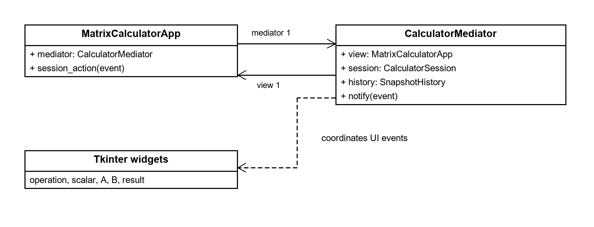
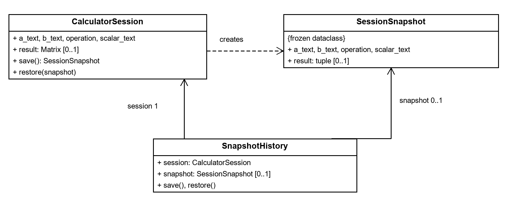
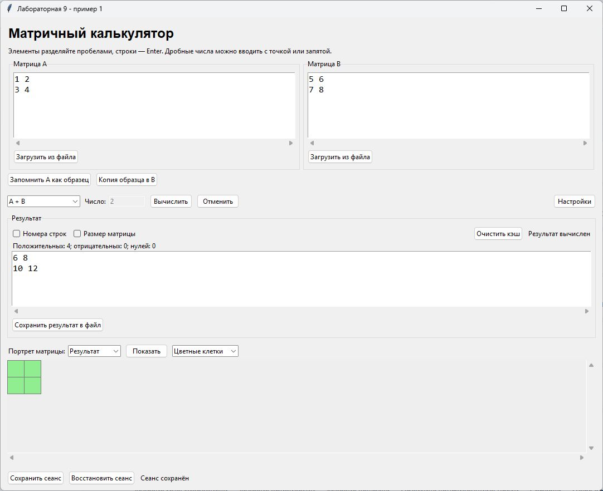
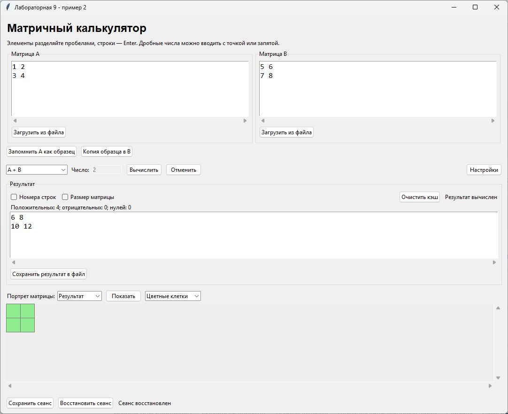

# Лабораторная работа 9
Посредник, Снимок

Цель работы: согласовать работу элементов окна через посредника и сохранять состояние калькулятора с помощью снимка.

Задача: применить паттерны, указанные в теме работы, в приложении «Матричный калькулятор».

Вариант 6 – Матричный калькулятор

Репозиторий проекта: https://github.com/Diana130613/patterny-proektirovaniya.

## Применение Посредника

Выбор операции влияет на поле множителя, а восстановление сеанса должно одновременно обновить поля A и B, операцию, результат и портрет. Если каждый элемент будет самостоятельно менять остальные, связи между ними станет трудно поддерживать. CalculatorMediator получает события и выполняет согласованные изменения в одном месте.



Рисунок 1 – Посредник и элементы интерфейса

Окно передаёт посреднику события operation_changed, save_session и restore_session. При выборе «A × число» посредник включает поле «Число», для остальных операций отключает его. При восстановлении он обновляет все связанные элементы, поэтому окно не остаётся в частично восстановленном состоянии.

## Исходный код Посредника:

```python
self.operation.bind("<<ComboboxSelected>>",
    lambda event: self.mediator.notify("operation_changed"))

if event == "operation_changed":
    enabled = self.view.operation.get() == "A × число"
    self.view.scalar.configure(
        state="normal" if enabled else "disabled")
```

Здесь приведены подключение события в окне и соответствующая ветвь notify(). Виджет сообщает об изменении, а решение о доступности другого поля принимает посредник. Сами матричные операции остаются в вычислительном сервисе.

## Применение Снимка

Снимок нужен, чтобы вернуться к сохранённому сеансу после пробных изменений. CalculatorSession является создателем снимка: только он определяет, какие данные сохранить и как их восстановить. SessionSnapshot хранит поля ввода, операцию, множитель и результат. SnapshotHistory запоминает снимок и просит сеанс восстановиться из него.



Рисунок 2 – Сеанс калькулятора и хранитель снимка

## Исходный код Снимка:

```python
@dataclass(frozen=True)
class SessionSnapshot:
    a_text: str
    b_text: str
    operation: str
    scalar_text: str
    result: object
def save(self):
    data = (None if self.result is None else
            tuple(tuple(row) for row in self.result.data))
    return SessionSnapshot(self.a_text, self.b_text,
                           self.operation, self.scalar_text, data)
def restore(self, snapshot):
    self.a_text, self.b_text = snapshot.a_text, snapshot.b_text
    self.operation = snapshot.operation
    self.scalar_text = snapshot.scalar_text
    self.result = (None if snapshot.result is None
                   else Matrix(snapshot.result))
```

Результат превращается в кортежи, поэтому последующие изменения Matrix не меняют снимок. При восстановлении создаётся новая матрица. Если результата ещё не было, сохраняется None и восстановление очищает поле результата.

```python
def restore(self):
    if self.snapshot is None:
        raise ValueError("Сначала сохраните сеанс.")
    self.session.restore(self.snapshot)
```

Хранитель не разбирает внутреннее содержимое снимка. В этой версии хранится один снимок в оперативной памяти: повторное сохранение заменяет предыдущий, закрытие приложения его удаляет. В снимок не входят настройки, кэш, образец матрицы и оформление портрета.

После восстановления история отмен очищается. Иначе кнопка «Отменить» могла бы вернуть результат из другого сеанса. Сохранение снимка и отмена команды решают разные задачи: снимок восстанавливает набор полей и результат, а команда отменяет отдельное вычисление.

## Результаты работы

Для исходных матриц вычислена сумма [[6, 8], [10, 12]], затем нажатие «Сохранить сеанс» создало снимок. В нижней части окна появилось сообщение «Сеанс сохранён».



Рисунок 3 – Сохранение исходных данных и суммы

## Восстановление сеанса

Матрица A заменена на [[9, 9], [9, 9]], выполнено вычитание. После нажатия «Восстановить сеанс» вернулись исходная A, операция A + B и сумма [[6, 8], [10, 12]]. Посредник повторно вывел результат и портрет.



Рисунок 4 – Восстановление сохранённого сеанса

Вывод: посредник сосредоточил правила взаимодействия элементов окна, а снимок позволил сохранять и восстанавливать сеанс независимо от последующих изменений матриц.
