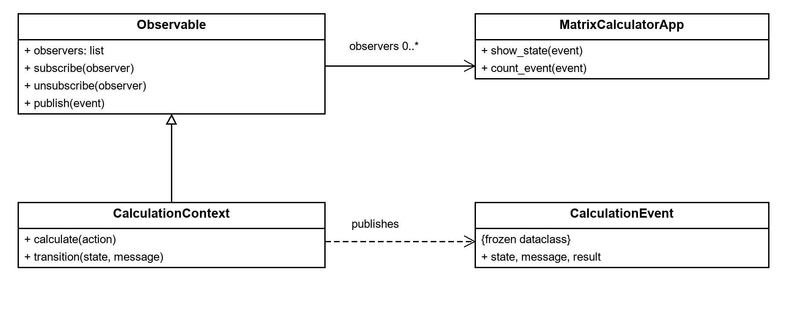
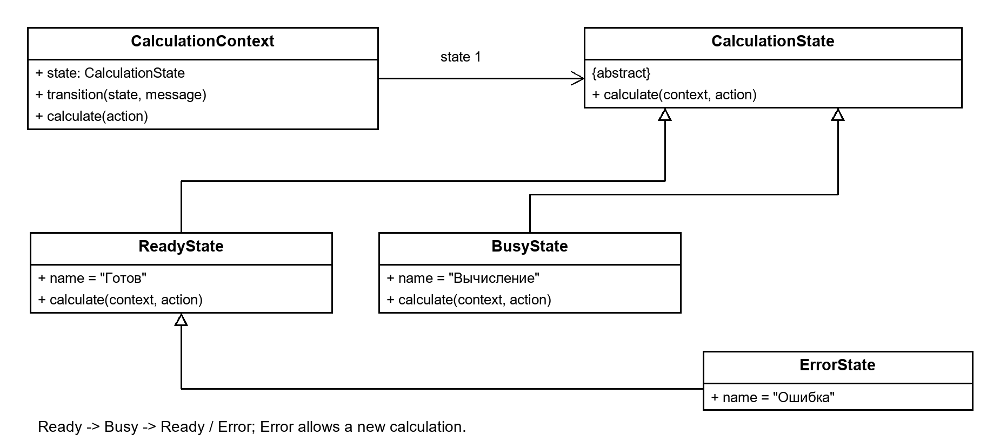
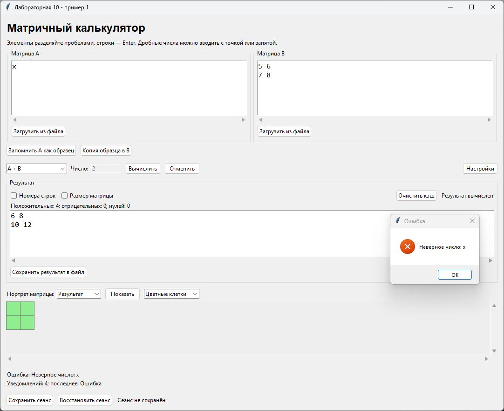
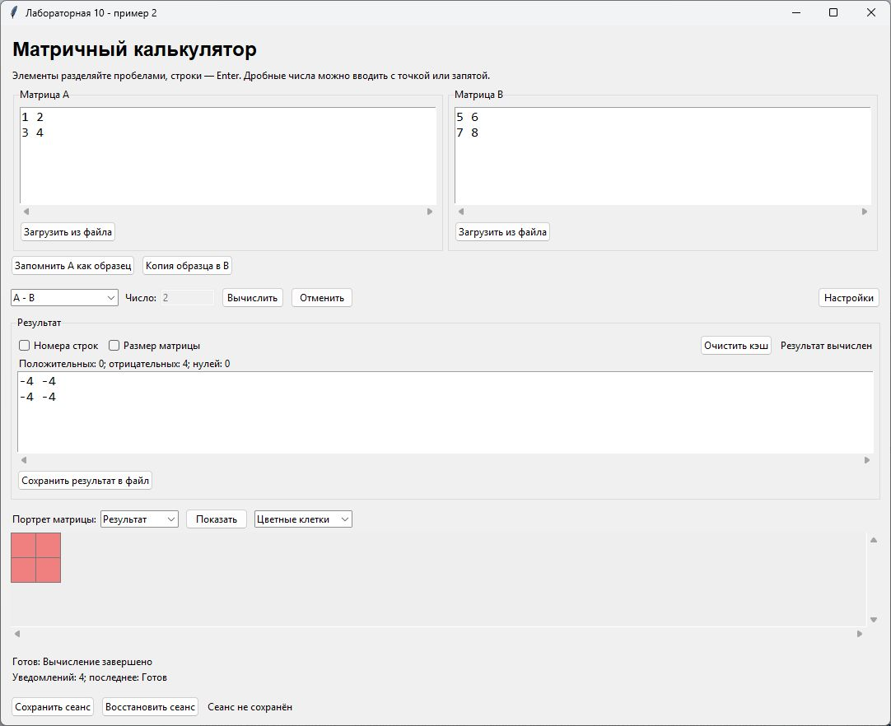

# Лабораторная работа 10
Наблюдатель, Состояние

Цель работы: уведомлять части интерфейса об изменениях и управлять поведением калькулятора через объекты состояний.

Задача: применить паттерны, указанные в теме работы, в приложении «Матричный калькулятор».

Вариант 6 – Матричный калькулятор

Исходный код: папка «Лабораторная 10», запуск python app.py. Репозиторий проекта: https://github.com/Diana130613/patterny-proektirovaniya.

## Применение Наблюдателя

О начале, завершении и ошибке вычисления нужно сообщать нескольким частям интерфейса. Наблюдатель позволяет подписать обработчики на эти события. Источник уведомлений не обязан знать, как именно подписчики показывают полученную информацию.



Рисунок 1 – Источник событий и подписчики окна

CalculationContext наследует Observable и публикует CalculationEvent. На него подписаны два метода: show_state() обновляет строку состояния, count_event() считает уведомления. Новый подписчик подключается через subscribe() без изменения вычислительной логики.

## Исходный код Наблюдателя

```python
class Observable:
    def __init__(self):
        self.observers = []

    def subscribe(self, observer):
        if observer not in self.observers:
            self.observers.append(observer)

    def unsubscribe(self, observer):
        self.observers.remove(observer)

    def publish(self, event):
        for observer in tuple(self.observers):
            observer(event)
def transition(self, state, message):
    self.state = state
    result = None if self.result is None else self.result.clone()
    self.publish(CalculationEvent(state.name, message, result))
self.context.subscribe(self.show_state)
self.context.subscribe(self.count_event)
```

Метод publish() вызывает каждого подписчика. Кортеж observers фиксирует состав подписчиков для текущего уведомления: изменение списка во время обработки не нарушит обход. unsubscribe() позволяет прекратить получение событий. В интерфейсе не нужно вручную обновлять оба индикатора после каждой ветви вычисления.

## Применение Состояния

Паттерн «Состояние» выносит поведение калькулятора в отдельные объекты. ReadyState разрешает вычисление. BusyState отклоняет повторный запрос, пока операция выполняется. ErrorState обозначает ошибку и наследует возможность повторного вычисления после исправления ввода.



Рисунок 2 – Контекст и объекты состояний

```python
def calculate(self, context, action):
    context.transition(BusyState(), "Выполняется вычисление")
    try:
        result = action()
    except (ValueError, OverflowError) as error:
        context.transition(ErrorState(), str(error))
        raise
    context.result = result.clone()
    context.transition(ReadyState(), "Вычисление завершено")
    return result
```

Контекст делегирует запрос текущему состоянию. Перед вызовом действия устанавливается BusyState. Успех возвращает ReadyState, а ошибка переводит в ErrorState и передаётся окну. Прошлый успешный результат при ошибке сохраняется. Вычисления выполняются синхронно; отдельный фоновый поток здесь не создаётся.

## Результаты работы

Сначала вычислена сумма исходных матриц. Затем в A введена буква x. Вместо нового результата показана ошибка «Неверное число: x». В журнал уведомлений отправлены события начала вычисления и перехода в состояние ошибки.



Рисунок 3 – Ошибка ввода при сохранении предыдущего результата

Последовательность состояний проверена отдельно: «Вычисление → Готов → Вычисление → Ошибка». После исправления ввода контекст вновь разрешает вычисление. Тест также проверяет отказ при вложенном вызове, пока активно состояние BusyState.

## Уведомления об успешном вычислении

На рисунке показаны два успешных вычисления: сложение и вычитание. Разность равна [[-4, -4], [-4, -4]]. На каждое вычисление отправлено два события, поэтому счётчик показывает четыре уведомления, а последнее состояние – «Готов».



Рисунок 4 – Разность матриц и два подписчика событий

Вывод: наблюдатель разделил отправку события и обновление индикаторов. Состояние позволило задавать разрешённое поведение отдельными классами и возвращаться к работе после ошибки.
