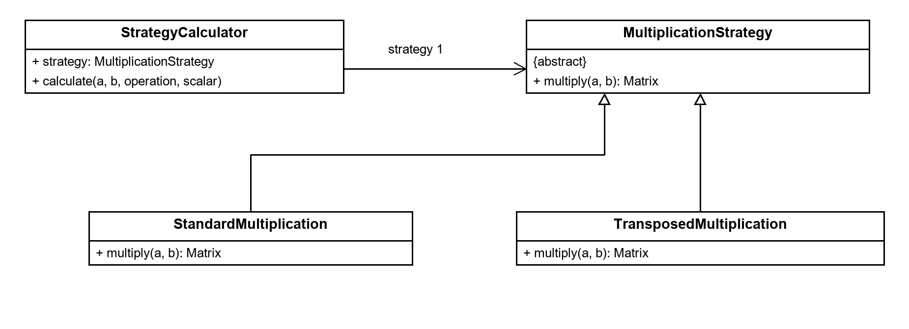
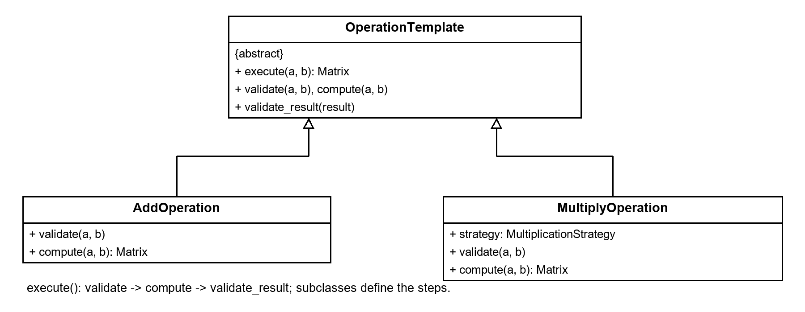
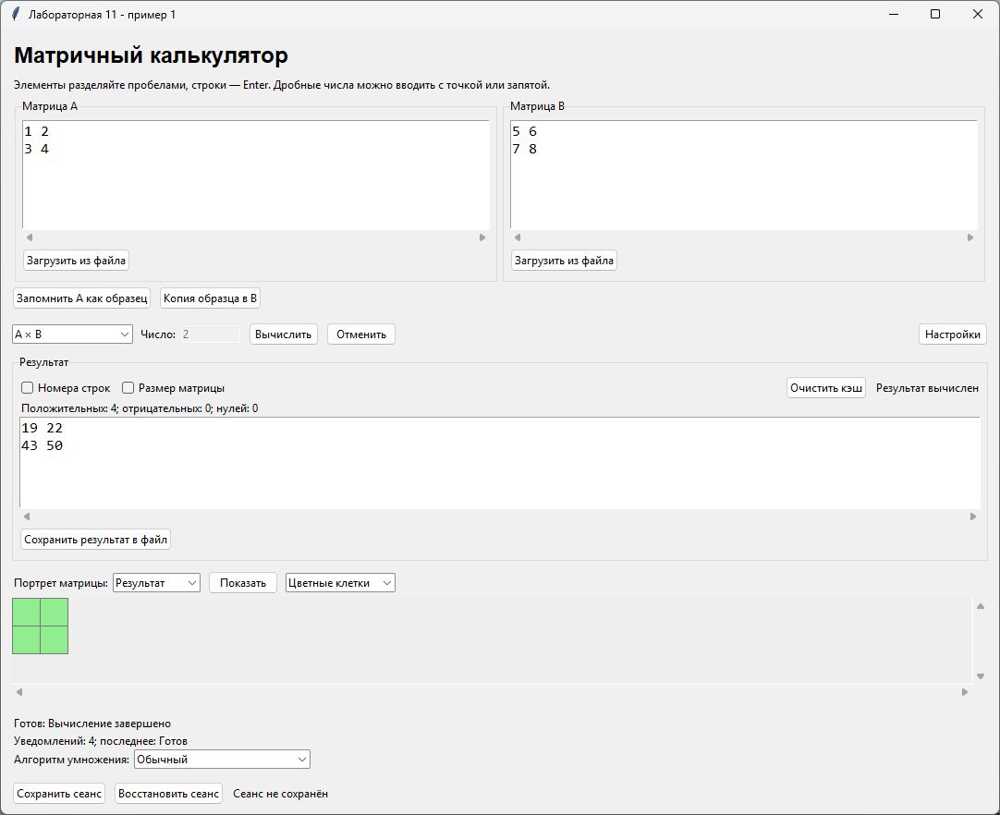
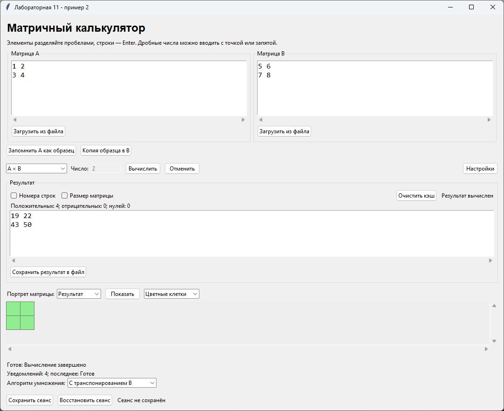

# Лабораторная работа 11
Поведенческие паттерны: стратегия, шаблонный метод

Цель работы: реализовать сменяемые алгоритмы умножения и общий порядок выполнения матричных операций.

Задача: применить указанные в теме паттерны в приложении «Матричный калькулятор».

Вариант 6 – Матричный калькулятор

Приложение написано на Python с интерфейсом Tkinter. Полные исходники находятся в папке лабораторной работы.

## Применение Стратегии

Одно умножение матриц можно выполнить разными алгоритмами. Паттерн «Стратегия» представляет каждый алгоритм отдельным объектом с общим способом вызова. Поэтому пользователь может менять алгоритм, а остальная программа продолжает обращаться к одному методу multiply().



Рисунок 1 – Контекст и алгоритмы умножения матриц

StrategyCalculator хранит выбранную стратегию. StandardMultiplication вызывает обычное умножение Matrix.multiply(). TransposedMultiplication сначала собирает столбцы B, затем считает скалярные произведения строк A и этих столбцов. Оба класса реализуют MultiplicationStrategy и возвращают Matrix.

## Исходный код Стратегии

```python
class StandardMultiplication(MultiplicationStrategy):
    def multiply(self, a, b):
        return a.multiply(b)
```

```python
class TransposedMultiplication(MultiplicationStrategy):
    def multiply(self, a, b):
        if a.columns != b.rows:
            raise ValueError("Несовместимые размеры матриц.")
        columns = list(zip(*b.data))
        return Matrix([[sum(x * y for x, y in zip(row, column))
                        for column in columns] for row in a.data])
```

В zip(*b.data) строки B преобразуются в последовательности её столбцов. Выражение sum(x * y ...) вычисляет один элемент произведения. При выборе другого алгоритма поле strategy заменяется новым объектом, а кэш очищается. Поэтому первый расчёт после переключения выполняется выбранным алгоритмом.

## Применение Шаблонного метода

У матричных операций есть общий порядок: проверить входные размеры, выполнить вычисление и проверить результат. Шаблонный метод закрепляет эту последовательность в OperationTemplate.execute(). Подклассы определяют содержание отдельных шагов.



Рисунок 2 – Общий сценарий выполнения операции

## Исходный код Шаблонного метода

```python
def execute(self, a, b):
    self.validate(a, b)
    result = self.compute(a, b)
    self.validate_result(result)
    return result
```

```python
class AddOperation(OperationTemplate):
    def validate(self, a, b):
        a.check_same_size(b)

    def compute(self, a, b):
        return a.add(b)
```

AddOperation проверяет совпадение размеров и складывает матрицы. MultiplyOperation проверяет возможность умножения и в compute() обращается к выбранной стратегии. Шаблонный метод задаёт порядок шагов через наследование, а стратегия подставляет алгоритм через отдельный объект.

## Результаты работы

Для A = [[1, 2], [3, 4]] и B = [[5, 6], [7, 8]] обычный алгоритм дал произведение [[19, 22], [43, 50]]. В интерфейсе выбран вариант «Обычный».



Рисунок 3 – Умножение обычным алгоритмом

После выбора «С транспонированием B» получено такое же произведение. Совпадение проверено также для прямоугольных матриц. В работе показана сменяемость алгоритмов; отдельное сравнение их скорости не выполнялось.



Рисунок 4 – Умножение с транспонированием B

Вывод: в результате выполнения лабораторной работы применены «Стратегия» и «Шаблонный метод». Стратегия позволяет выбирать алгоритм умножения, а шаблонный метод задаёт общий порядок выполнения матричных операций.
