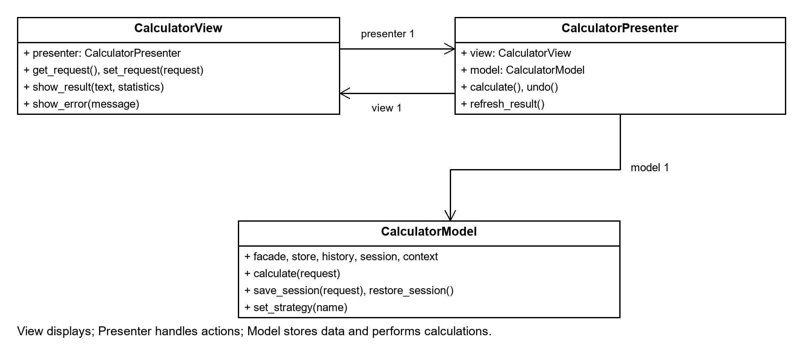
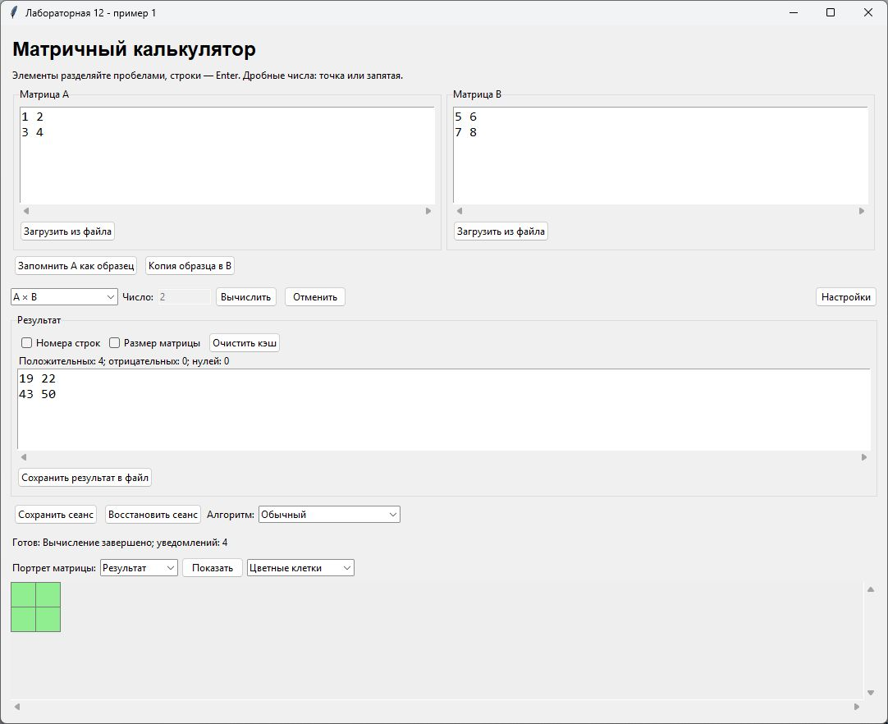

# Лабораторная работа 12
Архитектурные паттерны: MVP

Цель работы: разделить данные, интерфейс и управление калькулятором с помощью MVP.

Задача: применить указанные в теме паттерны в приложении «Матричный калькулятор».

Вариант 6 – Матричный калькулятор

Приложение написано на Python с интерфейсом Tkinter. Полные исходники находятся в папке лабораторной работы.

## Реализация и принцип работы

В предыдущих версиях класс окна содержал и построение интерфейса, и управление вычислениями. MVP разделяет эти обязанности между моделью, представлением и презентером. Благодаря этому действия калькулятора можно проверять без создания окна.



Рисунок 1 – Разделение приложения по MVP

CalculatorModel хранит данные и объединяет вычислительный сервис, кэш, историю команд, снимок, состояния и настройки. CalculatorView создаёт элементы Tkinter и показывает данные. CalculatorPresenter получает действия пользователя, вызывает модель и просит представление обновиться.

На диаграмме представление связано с презентером, а презентер связан с моделью и представлением. Модель не обращается к виджетам. В model.py и presenter.py нет импорта Tkinter.

## Исходный код модели и запуска

```python
def calculate(self, request):
    command = CalculateCommand(self.facade, self.store, *request)
    def action():
        self.history.execute(command)
        return self.store.result
    return self.context.calculate(action)
```

Модель получает значения запроса, создаёт команду и выполняет её через контекст состояния. Ей не нужны поля ввода и кнопки. ResultStore хранит результат, CommandHistory отвечает за отмену.

```python
def create_app(root):
    view = CalculatorView(root)
    presenter = CalculatorPresenter(CalculatorModel(), view)
    view.presenter = presenter
    presenter.start()
    return view
```

Функция create_app() создаёт окно, модель и презентер, затем связывает их. После этого элементы окна могут передавать действия презентеру.

## Исходный код презентера

```python
def calculate(self):
    try:
        self.model.calculate(self.view.get_request())
        self.refresh_result()
        self.view.select_result()
        self.show_portrait()
    except (ValueError, OverflowError) as error:
        self.view.show_error(str(error))
```

get_request() читает данные представления, model.calculate() запускает вычисление. Затем презентер обновляет текст результата и портрет. При ошибке вызывается show_error(), а способ показа сообщения остаётся в представлении.

Для проверки презентеру передаётся FakeView, обычный объект с нужными методами. Так в test_mvp.py проверяются вычисление, отмена, ошибочный ввод и восстановление снимка без окна. Отдельно проверены обработчики настоящего интерфейса.

## Результаты работы

После разделения на три части сохранены матричные операции, TXT и CSV, запись результата, настройки, портрет, образец, отмена и снимок. Для исходных A и B результат A × B равен [[19, 22], [43, 50]].



Рисунок 2 – Умножение матриц в приложении с MVP

Затем выполнена разность A − B и нажата кнопка «Отменить». Презентер обратился к истории модели и снова показал произведение. В строке состояния появилось сообщение «Вычисление отменено».


Рисунок 3 – Восстановление результата через презентер

Вывод: в калькуляторе применён MVP. Модель отвечает за данные и вычисления, представление за окно, презентер за обработку действий. Логику управления можно проверять независимо от Tkinter.
