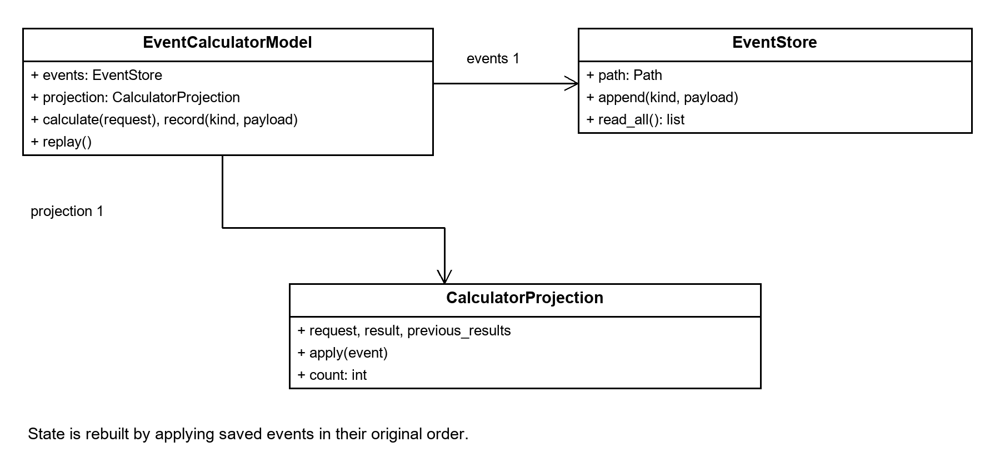
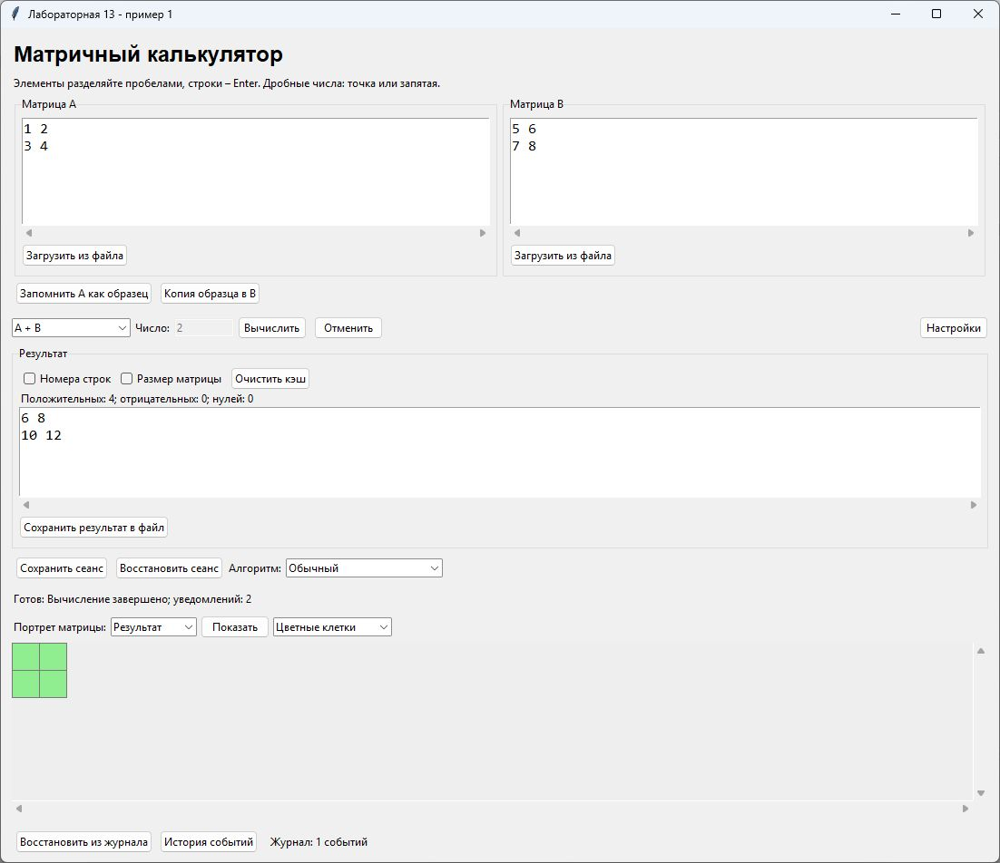
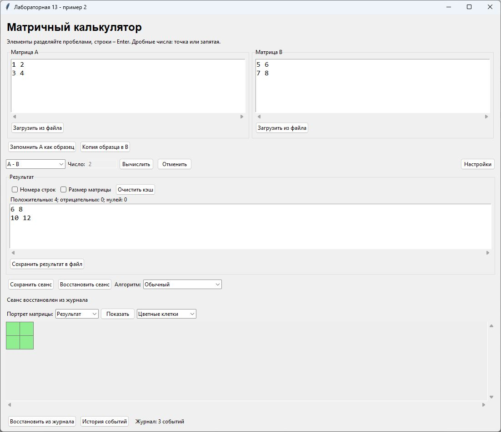

# Лабораторная работа 13
Паттерны микросервисов: Event Sourcing

Цель работы: сохранять изменения калькулятора как события и восстанавливать сеанс последовательным применением журнала.

Задача: применить указанные в теме паттерны в приложении «Матричный калькулятор».

Вариант 6 – Матричный калькулятор

Приложение написано на Python с интерфейсом Tkinter. Полные исходники находятся в папке лабораторной работы.

## Применение Event Sourcing

Обычный журнал может только сообщать, какие действия выполнялись. Event Sourcing делает сохранённые события источником для восстановления состояния. В этой работе калькулятор сохраняет успешные вычисления, отмену и восстановление снимка в events.jsonl, а при запуске заново применяет эти события.



Рисунок 1 – Модель, хранилище событий и проекция состояния

EventStore читает и дописывает события в файл. EventCalculatorModel получает действия приложения и записывает события. CalculatorProjection применяет их к данным: хранит последний запрос, результат и результаты для отмены. Текущее состояние получается из последовательности событий, а не из последней сохранённой матрицы.

calculated содержит запрос и результат вычисления. undone возвращает предыдущий результат, сохраняя текущие поля запроса. session_restored восстанавливает поля и результат из снимка и очищает историю отмен. Записи не удаляются при отмене: в журнал добавляется новое событие.

## Исходный код записи события

```python
def record(self, kind, payload):
    candidate = deepcopy(self.projection)
    candidate.apply({"kind": kind, "payload": payload})
    self.events.append(kind, payload)
    self.projection = candidate
    self.sync_result()
```

```python
def commit_result(self, request, result):
    self.record("calculated", {
        "request": list(request),
        "result": result.data})
    return self.store.result
```

Сначала событие проверяется на копии проекции. Затем оно записывается на диск, и только после успешной записи новая проекция становится текущей. Это сохраняет прежний результат при ошибке записи. Числа в событии копируются через JSON, поэтому дальнейшие изменения объектов не меняют журнал.

## Восстановление состояния

```python
def replay(self):
    projection = CalculatorProjection()
    for event in self.events.read_all():
        projection.apply(event)
    self.projection = projection
    self.sync_result()
    return projection.request
```

replay() начинает с пустой проекции и вызывает apply() для каждого события в исходном порядке. Математические операции повторно не выполняются: применяются уже записанные результаты и действия. После обхода состояние передаётся в ResultStore, а презентер обновляет окно.

Журнал хранится рядом с программой и используется одним экземпляром приложения. Каждая строка содержит номер, вид события и данные. Неверная строка или неизвестный вид события приводят к сообщению об ошибке; повреждённый журнал не очищается автоматически.

## Результаты работы

Для исходных A и B вычислена сумма [[6, 8], [10, 12]]. В журнал добавлено одно событие calculated, что видно по счётчику внизу окна.



Рисунок 2 – Сохранение события успешного вычисления

Затем выполнено вычитание, отменено последнее вычисление и запущено восстановление из журнала. После применения трёх событий вернулась сумма. Выбранная операция остаётся A − B, поскольку отмена возвращает только результат. Такая же последовательность проверена после повторного создания модели с тем же файлом.



Рисунок 3 – Восстановление суммы после вычисления и отмены

Вывод: реализован Event Sourcing. События сохраняются последовательно, а состояние калькулятора восстанавливается их повторным применением. Сохранены история изменений и возможность отмены после перезапуска.
