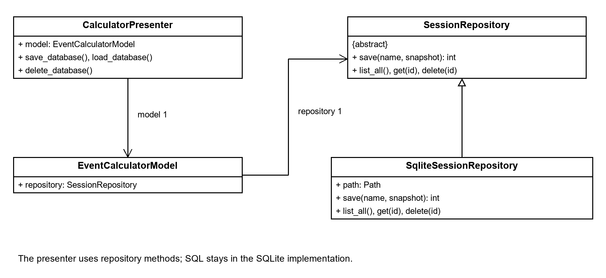
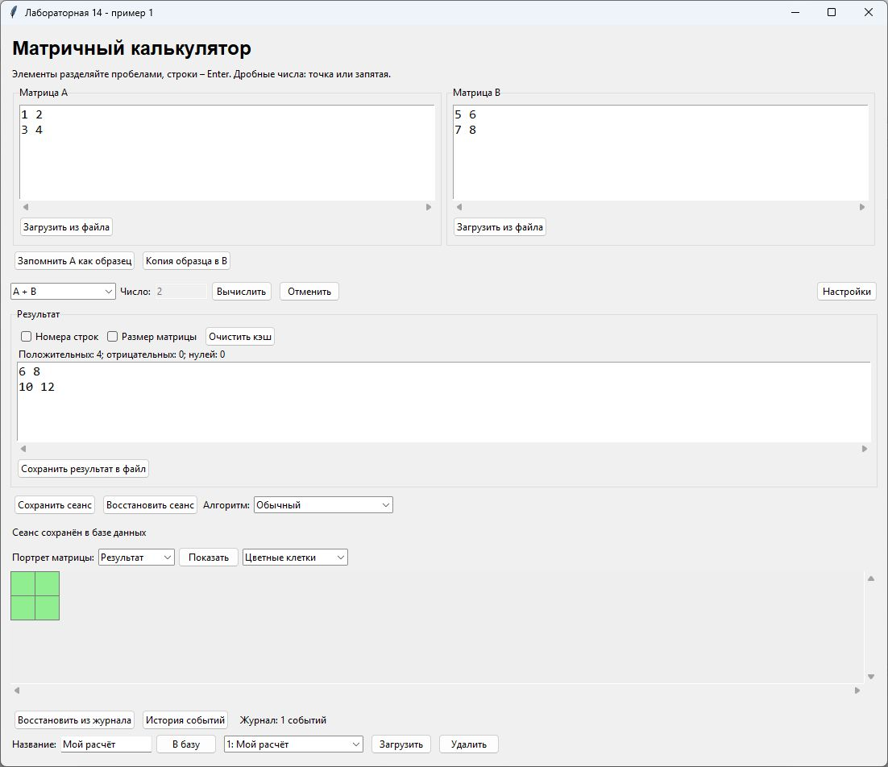

# Лабораторная работа 14
Системные паттерны: Repository

Цель работы: отделить работу с базой данных от логики приложения и сохранять сеансы через репозиторий.

Задача: применить указанные в теме паттерны в приложении «Матричный калькулятор».

Вариант 6 – Матричный калькулятор

Приложение написано на Python с интерфейсом Tkinter. Полные исходники находятся в папке лабораторной работы.

## Применение Repository

Для сохранения сеансов в базе данных приложению нужны операции сохранения, поиска и удаления. Если SQL разместить в обработчиках окна, интерфейс будет зависеть от устройства таблиц. Repository предоставляет общие методы работы с данными и скрывает конкретный способ хранения.



Рисунок 1 – Общий репозиторий и реализация для SQLite

SessionRepository определяет методы save(), list_all(), get() и delete(). SqliteSessionRepository реализует их с помощью sqlite3. Ссылка repository хранится в модели, а презентер обращается к этим методам через неё. SQL находится только в repository.py.

В таблице sessions сохраняются номер записи, название и JSON с полями A и B, операцией, множителем и результатом. Данные записываются в sessions.db рядом с приложением и доступны после закрытия окна. Журнал событий из предыдущей работы продолжает работать отдельно.

## Исходный код репозитория

```python
def save(self, name, snapshot):
    if not name.strip():
        raise ValueError("Введите название сеанса.")
    data = {"a": snapshot.a_text, "b": snapshot.b_text,
            "operation": snapshot.operation,
            "scalar": snapshot.scalar_text, "result": snapshot.result}
    text = json.dumps(data, ensure_ascii=False, allow_nan=False)
    with self.connect() as connection:
        cursor = connection.execute(
            "INSERT INTO sessions(name, data) VALUES (?, ?)",
            (name.strip(), text))
        return cursor.lastrowid
```

Название проверяется на пустоту. Поля снимка преобразуются в JSON, а INSERT добавляет новую запись. Знаки вопроса являются параметрами запроса: название и данные передаются отдельно от SQL. cursor.lastrowid возвращает номер созданного сеанса. Повторное сохранение создаёт отдельную запись.

```python
def list_all(self):
    with self.connect() as connection:
        return connection.execute(
            "SELECT id, name FROM sessions ORDER BY id").fetchall()
```

list_all() возвращает список номеров и названий для выбора в окне. get() загружает запись по номеру, проверяет содержимое и возвращает SessionSnapshot. delete() удаляет только выбранную запись. Контекст connect() фиксирует изменения и закрывает соединение.

## Обращение из презентера

```python
key = self.model.repository.save(
    self.view.session_name.get(), self.model.snapshots.snapshot)
self.view.update_saved_sessions(
    self.model.repository.list_all(), key)
```

Презентер просит модель создать снимок, затем передаёт его репозиторию. При загрузке получает снимок через get() и использует существующее восстановление сеанса. Элементы окна не выполняют SQL и не знают структуру таблицы.

## Результаты работы

Для исходных A и B вычислена сумма [[6, 8], [10, 12]]. Сеанс сохранён под названием «Мой расчёт». В списке появилась запись с номером 1.



Рисунок 2 – Сохранение именованного сеанса в SQLite

После изменения A и вычисления разности выбрана сохранённая запись и нажата кнопка «Загрузить». Поля и сумма восстановились из базы. Отдельная проверка повторно открыла файл базы, загрузила сеанс и удалила запись через репозиторий.


Рисунок 3 – Загрузка сохранённого сеанса из базы

Вывод: в калькуляторе применён Repository. Работа с SQLite отделена от интерфейса и доступна через общие методы. Пользователь может сохранять несколько именованных сеансов, загружать и удалять их.
