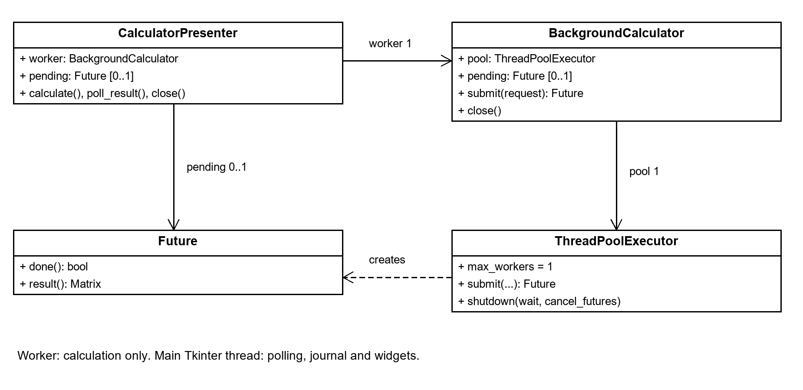
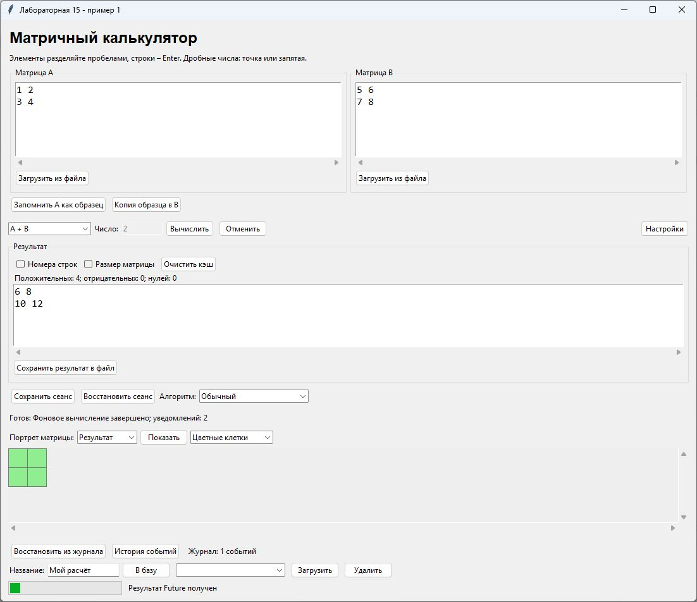

# Лабораторная работа 15
Идиоматические паттерны: пул потоков и Future

Цель работы: выполнять вычисления в рабочем потоке и получать результат через Future, сохраняя обработку интерфейса в основном потоке.

Задача: применить указанные в теме паттерны в приложении «Матричный калькулятор».

Вариант 6 – Матричный калькулятор

Приложение написано на Python с интерфейсом Tkinter. Полные исходники находятся в папке лабораторной работы.

## Применение пула потоков и Future

Если выполнять длительное вычисление прямо в обработчике кнопки Tkinter, окно не сможет вовремя обрабатывать события. Пул потоков позволяет передать расчёт рабочему потоку. Future представляет будущий результат: по нему можно проверить готовность и получить матрицу либо ошибку.



Рисунок 1 – Рабочий поток, Future и презентер

BackgroundCalculator создаёт ThreadPoolExecutor с одним рабочим потоком. submit() отправляет ему запрос и возвращает Future. CalculatorPresenter хранит ссылку pending и проверяет её через root.after(). Рабочий поток выполняет только расчёт; запись события и обновление виджетов происходят в основном потоке.

## Исходный код фонового запуска

```python
def submit(self, request):
    if self.pending is not None and not self.pending.done():
        raise ValueError("Вычисление уже выполняется.")
    self.pending = self.pool.submit(
        self.calculator.calculate, *request)
    return self.pending
```

До запуска проверяется, нет ли незавершённой задачи. Данные считываются из полей заранее и передаются как строки. Поэтому рабочий поток не обращается к Tkinter. На время расчёта элементы изменения данных отключаются, запускается индикатор, но цикл событий окна продолжает работать.

## Проверка готовности и получение результата

```python
if not self.pending.done():
    self.poll_id = self.view.root.after(50, self.poll_result)
    return
result = self.pending.result()
self.model.commit_result(self.request, result)
```

done() не ждёт окончания расчёта, а сразу сообщает его состояние. Если задача не готова, следующая проверка назначается через 50 мс. result() вызывается только после готовности, поэтому не блокирует окно ожиданием. При успехе результат записывается в журнал и выводится; при ошибке показывается сообщение, а прежний результат сохраняется.

```python
def close(self):
    self.pool.shutdown(wait=False, cancel_futures=True)
```

При закрытии окна отменяется запланированная проверка и запрещается добавление новых задач. Ещё не начатые задачи отменяются. Уже работающий поток не прерывается принудительно: он заканчивает расчёт, после закрытия окно больше не обновляется.

## Результаты работы

Для A = [[1, 2], [3, 4]] и B = [[5, 6], [7, 8]] Future вернул сумму [[6, 8], [10, 12]]. Окно показало результат и сообщение «Результат Future получен». Сохранение в базу, журнал и восстановление сеанса доступны после завершения расчёта.



Рисунок 2 – Получение результата фонового вычисления

В проверке рабочая задача удерживалась отдельным сигналом, пока цикл Tkinter продолжал обрабатываться. Проверено, что таймер готовности вызывается до завершения задачи, а поля ввода отключены. После освобождения задачи получен результат и восстановлена доступность элементов. Также проверены ошибочный ввод и запрет повторного запуска.

Вывод: расчёт передан пулу потоков, а результат получен через Future. Обработка окна отделена от вычисления, и виджеты обновляются в основном потоке. Цель решения состоит в сохранении отзывчивости интерфейса, а не в ускорении математического алгоритма.
